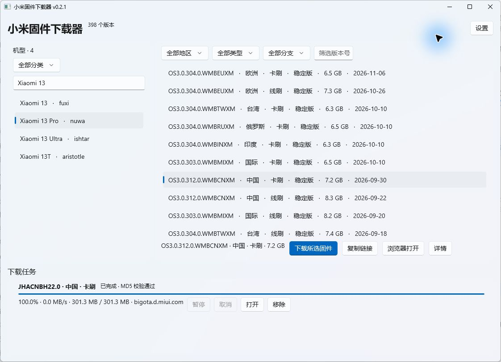

# 小米固件下载器

在 Windows 上查找和下载小米、Redmi、POCO 的 MIUI 与 HyperOS 固件。按机型名称或代号搜索，用地区和刷机方式筛选版本。支持官方 CDN 测速、断点续传和 MD5 校验。

MiFirmware Downloader is a Rust and WinUI 3 app for browsing and downloading Xiaomi, Redmi, and POCO ROMs on Windows. Filter MIUI and HyperOS releases by device, region, or package type.



## 功能

- **机型与版本** · 支持机型分类和代号搜索，按地区、卡刷、线刷或版本号寻找固件。最新版本与历史版本由 XiaomiFirmwareUpdater 和 XiaomiROM 提供。
- **下载与校验** · 对官方 CDN 测速，并在写盘前核对响应的字节范围。来源提供 MD5 时，校验通过后才生成最终文件。有 MD5 的任务可选用多条合格线路，无 MD5 时使用单一 HTTPS 线路。
- **暂停与恢复** · 下载器会保存已完成的分块。重新启动应用后，选择同一固件和下载目录即可尝试继续。有 MD5 或线路提供稳定的 ETag 时可恢复分块；缺少标识时从头下载。
- **多任务下载** · 默认同时下载 2 个任务，每个任务最多使用 32 个连接。可在设置中修改下载目录、连接数、并发数和系统代理。

## 下载与运行

从 [Releases](../../releases) 下载 `MiFirmware-Downloader.exe`，双击运行。选择机型后核对地区和卡刷或线刷类型，再点「下载所选固件」。

需要系统已安装 **Windows App SDK 运行时**（Windows 11 一般自带；也可装
`Microsoft.WindowsAppRuntime.1.7` 及以上）。

默认优先保存到 `D:\XiaomiFirmware`。没有 D 盘时，保存到用户的「下载」文件夹下的 `XiaomiFirmware`。

## 构建

需要 Rust 1.95+ 与 MSVC 工具链（`rustc`/`cargo` + Windows SDK 的 `rc.exe`）。

```bash
cargo test --locked --bin mifw_winui
cargo build --locked --release
# 产物：target/release/mifw_winui.exe
```

GitHub Actions 会在 Windows 上运行回归测试、构建并上传可执行文件。

## 项目结构

```
src/
├─ main.rs       Reactor 组件：界面、状态、消息
├─ catalog.rs    XiaomiFirmwareUpdater + xiaomirom 解析与缓存
├─ download.rs   多线路测速、双线路并行分段、续传、MD5
├─ config.rs     设置持久化
└─ net.rs        HTTP / CDN 候选 / Referer
tools/gen_icon.py  图标生成脚本（Pillow）
```

## 实现要点

- 小米 CDN 对无 `Referer` 的请求返回 403，所有请求都带 `Referer: https://www.mi.com/`
- 下载前在候选线路上请求 256 KiB 样本。有 MD5 时，最多并行使用四条支持分段的同大小线路。
- XiaomiROM 历史直链按需解析，必须与所选版本及刷机类型匹配。
- WinUI 3 使用 [windows-reactor](https://crates.io/crates/windows-reactor) 声明式 API，无 XAML 文件

## 数据来源与免责声明

- 版本数据来自开源项目 [XiaomiFirmwareUpdater](https://github.com/XiaomiFirmwareUpdater/miui-updates-tracker) 与第三方站点 xiaomirom.com 的公开页面；本项目只解析**公开可访问的页面**，运行时会以较低频率请求，请遵守对应站点的使用条款
- 所有下载链接均指向**小米官方 CDN**，本项目不托管、不分发任何固件，也不修改固件
- 与小米公司无任何关联；Xiaomi、Redmi、POCO、MIUI、HyperOS 等商标归各自所有者
- 刷机有风险，请自行核对机型与版本，后果自负

## 路线图

- [ ] 下载器：动态分块重平衡、块级换线重试
- [ ] 多选批量下载、完成通知、收藏机型
- [ ] 代理设置、拼音搜索
- [ ] 安装包（MSIX / Inno Setup）与自动更新

## License

[MIT](LICENSE)

## 更新日志

### v0.2.1

- 历史版本加载和排序时保留所选固件，历史直链按版本和刷机类型匹配。
- 校验分段响应和断点身份，显示 MD5 校验状态，并保护已有目标文件。
- 下载队列按目标去重，等待当前下载线程退出后再恢复任务。失败时显示原因并提供重试。
- 旧版断点文件缺少固件身份。首次使用新版恢复旧任务时，会重新下载对应固件。

### v0.2.0

- 修复慢线路上「下载速度几乎为 0」：原来 30 秒总超时 + 64 MB 大块，慢线路每块必然超时、无限重试；改为 600 秒超时 + 1–8 MB 小块
- 测速最多等 4 秒，不再卡住启动；失败时按 cdnorg → bn → 阿里云 → bigota 顺序兜底
- 块级多线路轮询 + 线路健康度降级、指数退避，单条线路抖动不再拖垮整体
- 实测小米 CDN 的 HTTP(80) 明显快于 HTTPS（cdnorg 4.6 vs 1.9 MB/s），候选线路加入 HTTP 变体由测速自动择优
- 默认连接数 16 → 32
- 新增「使用 Windows 系统代理」开关（读系统代理设置，可借用 Clash / v2ray 出口）
- `.meta` 改为原子写，断电不再写坏；下载前预检磁盘空间；新增 `logs/app.log` 日志
